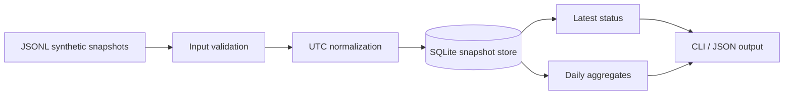

# DayZ Server Monitor — Python Data Pipeline Demo

**Server status snapshots · SQLite · time-series summaries · automated tests**

[](https://github.com/Scumbagsss/dayz-server-monitor-bot/actions/workflows/monitor-demo.yml)


> This repository combines a **private-source DayZ monitoring case study** with an **original, independently runnable demonstration**. The demonstration uses fictional status records. It does not connect to any real server or disclose production monitoring code.

## What problem does it solve?

A game-server operations team needs more than a single "online" indicator. Availability changes, player counts and queue trends become useful only when readings are validated, timestamped and stored as history.

The private project integrates server data with Discord status reporting. This public example focuses on the **data ingestion and persistence side** using Python's standard library.

## Run the demo

Requires **Python 3.11 or newer**. No Discord token, third-party dependencies or server access is required.

```bash
python monitor_demo.py --db demo-monitor.sqlite3
python -m unittest discover -s tests -v
```

The command imports [fictional JSONL readings](fixtures/demo_snapshots.jsonl), stores them in a local SQLite file and prints the latest reading and daily statistics as JSON. This dataset is only a demonstration and does not represent real uptime.

## Public demo capabilities

| Capability | Implementation |
|---|---|
| Ingestion | JSON Lines with input validation and line-numbered errors |
| Timestamps | Parse ISO 8601, require timezone, normalize to UTC |
| Storage | SQLite, parameterized SQL, persistent history |
| Retries / duplicates | Upsert by server name and timestamp |
| Retrieval | Query latest server reading |
| Reporting | Daily count, availability among samples, mean/peak players and peak queue |
| Automated tests | **26 synthetic tests** across parsing, persistence, duplicates and summaries |
| CI | Python **3.11, 3.12 and 3.13** matrix |

The daily availability percentage is based on the **fraction of stored samples marked available**, not a time-weighted SLA or an uptime guarantee.

## Architecture



## Relation to the private Discord project

The original monitoring project includes server-query integration, online and queue tracking, historical activity reporting and Discord-facing status messages. Production adapters, credentials, deployment configurations and source remain private. The code in `monitor_demo.py` is a standalone example, not a reduced copy of the production polling service.

The private integration may involve `discord.py`, `aiosqlite`, `matplotlib` and Steam server data; the public demo needs only SQLite and the standard library.

## Repository guide

- [`monitor_demo.py`](monitor_demo.py) — runnable synthetic data pipeline
- [`tests/test_monitor_demo.py`](tests/test_monitor_demo.py) — 26 unit tests
- [`fixtures/demo_snapshots.jsonl`](fixtures/demo_snapshots.jsonl) — fabricated snapshots
- [`.github/workflows/monitor-demo.yml`](.github/workflows/monitor-demo.yml) — automated validation
- [`docs/ARCHITECTURE.md`](docs/ARCHITECTURE.md) — private system boundary
- [`src/public_interface.py`](src/public_interface.py) — non-runnable private interface sketch

## Limitations

This is a single-process educational example: no live polling, network retry scheduler, rate limiting, authentication or deployment automation. Synthetic samples cannot establish live reliability or usage metrics.

**Author:** [Scumbagsss](https://github.com/Scumbagsss) · Python Backend · Automation
